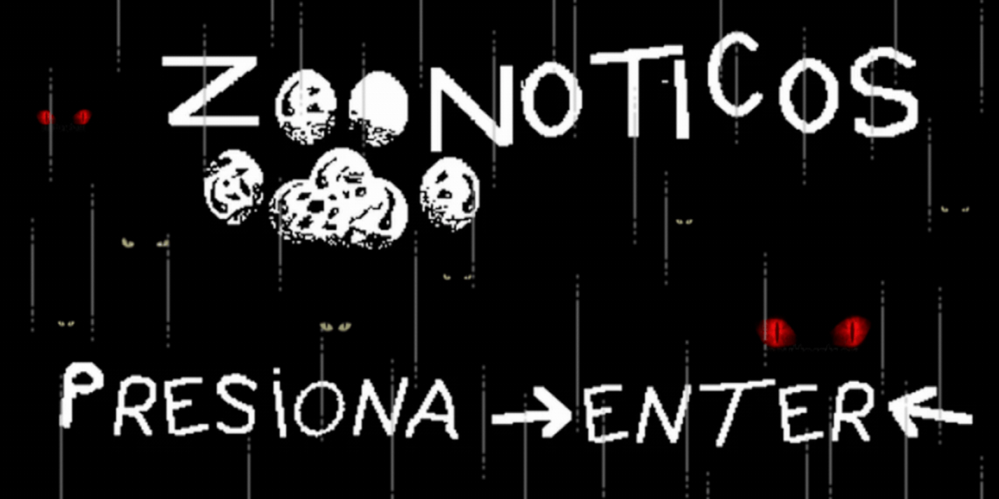
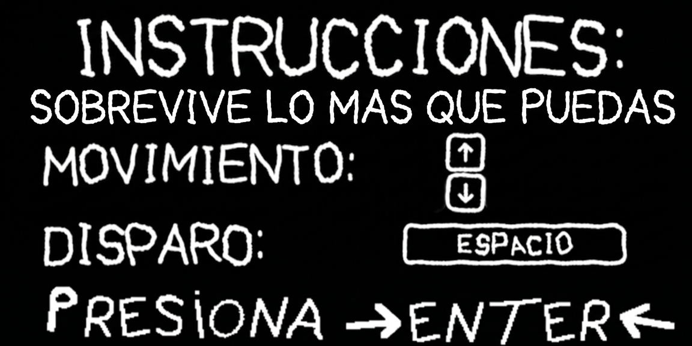
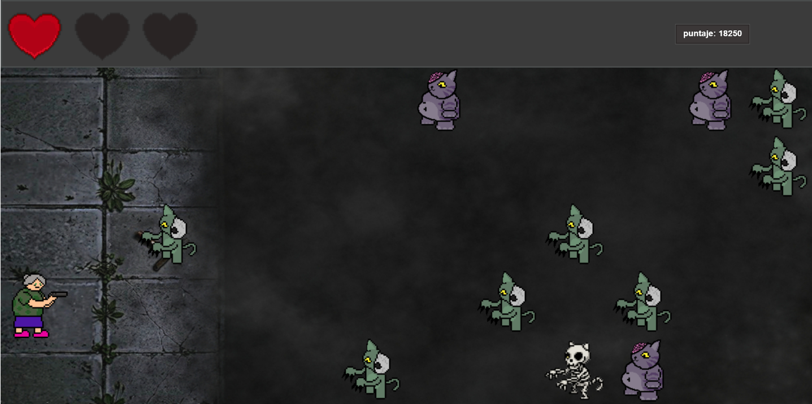

# zoonoticos

## Equipo de desarrollo

Asisol, Sheila Nahir  
Battilana, Iván Agustín  
Contreras, Santiago Gastón  
Ramos, Leandro Leonel  

## Capturas

## Reglas de Juego / Instrucciones
En Zoonosis tenés que matar a los zombies invasores para sobrevivir:
Tenes 3 vidas y para mantenerlas nadie tiene que pasar por los caminos que custodias.
⬆⬇: para moverte.
Espacio: para disparar.
## Otros
- Programación con objetos 1
- Wollok Lang 4.0.0
